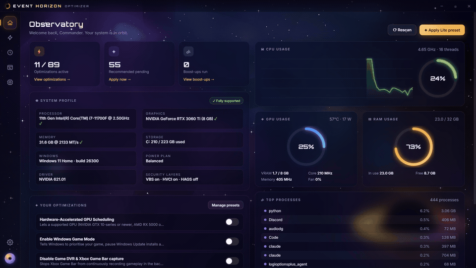
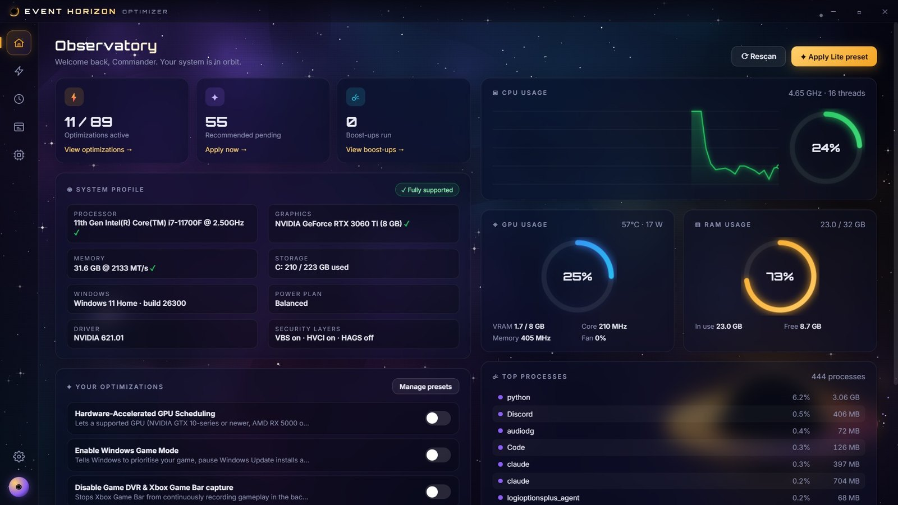
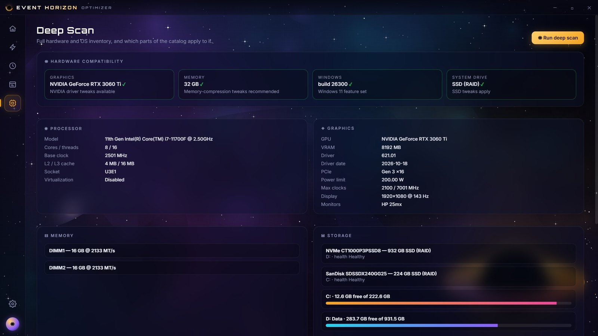
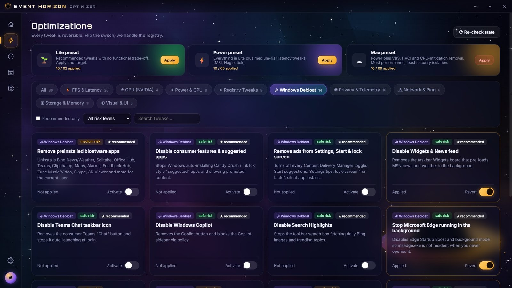
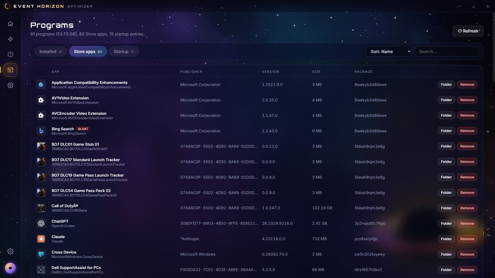

<div align="center">


# Event Horizon

**Free, open-source FPS, latency and debloat optimizer for Windows 11.**<br>
89 audited tweaks. Every one reversible. Zero telemetry of its own.

[](https://github.com/muhzain05/Event-Horizon/actions/workflows/ci.yml)
[](https://github.com/muhzain05/Event-Horizon/actions/workflows/codeql.yml)
[](https://github.com/muhzain05/Event-Horizon/releases/latest)
[](LICENSE)


<!-- DEMO_LINK -->



**[⬇ Download for Windows](https://github.com/muhzain05/Event-Horizon/releases/latest)** · [Tweak catalog](docs/TWEAKS.md) · [Rollback](#rollback) · [Troubleshooting](#troubleshooting)

</div>

---

## Why Event Horizon

Most "game boosters" are closed source, ask for an account, and never tell you what they changed. Event Horizon takes the opposite approach.

- **Every change is readable.** Each tweak is three short PowerShell snippets in [`src/main/tweaks.js`](src/main/tweaks.js): apply, revert and check.
- **Every change is reversible.** Flip the toggle back, or use **Revert all** in Settings.
- **The UI shows the truth.** Toggle states are read live from the registry, services, `powercfg`, `bcdedit` and `fsutil` on every launch, so they reflect your machine, not a saved guess.
- **Nothing phones home.** The interface makes no network requests (enforced by a `connect-src 'none'` content security policy and a test). No accounts, no telemetry, no premium tier.
- **Risk is labelled.** Tweaks are marked safe, medium or high. High-risk tweaks ask for confirmation and recommend a restore point first.

> [!NOTE]
> No FPS or latency numbers are claimed here. Results depend on your hardware, drivers and games. If you benchmark before and after, please share your results in [Discussions](https://github.com/muhzain05/Event-Horizon/discussions).

## Features

<table>
<tr>
<td width="50%" valign="top">

### 🔭 Observatory
Live CPU, GPU and RAM telemetry, a CPU history graph, top processes by real CPU %, and a profile of your hardware and security state.

</td>
<td width="50%" valign="top">

### ⚡ 89 optimizations
FPS & latency, NVIDIA driver, power & CPU, registry, Windows debloat, privacy & telemetry, network, storage & memory, visual. Three presets: **Lite**, **Power**, **Max**.

</td>
</tr>
<tr>
<td valign="top">

### 🛰 Deep Scan
CPU, GPU (PCIe link, power limit, clocks), memory modules, disks, network adapters, monitors and BIOS. Shows which parts of the catalog apply to your machine.

</td>
<td valign="top">

### 🗂 Programs, done properly
Installed programs with icons, sizes and install dates, normal and silent uninstall. Store apps with bloatware flagged. Startup entries from the registry, Startup folders and logon tasks, each one toggleable.

</td>
</tr>
<tr>
<td valign="top">

### ☄ Boost-ups
13 one-shot maintenance actions: junk and temp cleaner, shader-cache rebuild, free standby memory, DNS and Winsock reset, SSD retrim, Windows Update cache reset, Steam cleaner, restore point and more.

</td>
<td valign="top">

### 🛡 Safety net
Restore-point boost-up, per-tweak revert, **Revert all**, reboot prompts for kernel-level changes, and an activity log of everything the app did.

</td>
</tr>
</table>

<details>
<summary><b>Screenshots</b></summary>
<br>

| Observatory | Deep Scan |
|---|---|
|  |  |
| **Optimizations** | **Store apps** |
|  |  |

All screenshots are the real app, captured in demo mode, which hides the host name, user name and MAC addresses.

</details>

## The catalog at a glance

| Category | Tweaks | Examples |
|---|---:|---|
| FPS & Latency | 20 | Hardware-accelerated GPU scheduling, Game DVR off, fullscreen optimizations, MMCSS priority, timer resolution, MSI mode, VBS / HVCI (high risk) |
| GPU (NVIDIA) | 4 | NVIDIA telemetry off, per-core DPC, keep shader cache, block Windows Update driver swaps |
| Power & CPU | 9 | Ultimate Performance plan, core parking, power throttling, USB suspend, PCIe ASPM, hibernation |
| Storage & Memory | 11 | Memory compression, SysMain, NTFS last-access, TRIM check, search indexing |
| Registry | 9 | Shutdown timeouts, startup delay, error reporting, maintenance, classic context menu |
| Windows Debloat | 14 | Preinstalled apps, suggested apps, Widgets, Copilot, Teams chat, Edge background, OneDrive, Xbox services |
| Privacy & Telemetry | 10 | Diagnostic data, advertising ID, activity history, Bing in Start, location, feedback prompts |
| Network & Ping | 6 | Nagle, network throttling, TCP stack, adapter power saving, interrupt moderation, DNS |
| Visual & UI | 6 | Animations, transparency, menu delay, thumbnails, lock screen |

Full list with risk levels and descriptions: **[docs/TWEAKS.md](docs/TWEAKS.md)** (generated from the source, checked in CI).

## Install

1. Download from the [latest release](https://github.com/muhzain05/Event-Horizon/releases/latest):
   - `EventHorizon-Portable-<version>.exe`: single file, nothing installed.
   - `EventHorizon-<version>-x64.exe`: installer with Start-menu entry and uninstaller.
2. Optional: verify the download against `SHA256SUMS.txt` from the same release.
   ```powershell
   Get-FileHash .\EventHorizon-Portable-1.0.0.exe -Algorithm SHA256
   ```
3. Run it and accept the UAC prompt. Tweaks write to `HKLM`, services and boot settings, so the app needs administrator rights. 19 user-level tweaks also work without elevation.

> [!IMPORTANT]
> The executables are not code-signed yet, so Windows SmartScreen will show "Windows protected your PC". Click **More info → Run anyway**, or build it yourself from source (below). Signing is on the roadmap.

**Requirements:** Windows 11, x64. Windows 10 22H2 should work but is untested. NVIDIA-specific tweaks are disabled automatically on other GPUs.

## Usage

1. **Create a restore point first.** Boost-Ups → *Create System Restore Point*, or Settings → *Create*.
2. **Start with the Lite preset.** It only contains tweaks rated safe.
3. **Add tweaks individually.** Filter by category, risk or the *Recommended only* switch. Read the description before you flip anything rated medium or high.
4. **Reboot when asked.** Tweaks marked ⟳ (14 of them) change kernel or boot settings and apply after a restart.
5. **Run boost-ups occasionally.** They are one-shot clean-ups, not toggles.

## Rollback

There are four layers, from finest to broadest:

| Layer | How | Notes |
|---|---|---|
| One tweak | Flip its toggle off | Runs that tweak's `revert` script and re-checks the live state. |
| Everything | Settings → **Revert all** | Reverts every tweak currently detected as applied. Reboot afterwards. |
| Restore point | Boost-Ups → *Create System Restore Point* before you start; roll back with `rstrui.exe` | Covers registry, services and drivers. |
| By hand | See the `revert` snippet for any tweak in [`src/main/tweaks.js`](src/main/tweaks.js) | Each is a few lines of plain PowerShell. |

> [!WARNING]
> **Revert restores the Windows default, not your previous value.** If you had customised a setting before running Event Horizon (for example a non-default `MenuShowDelay`), reverting sets the Windows default. Use a restore point if you need your exact previous configuration back.

Boot-configuration tweaks can also be undone from an elevated terminal:

```powershell
bcdedit /deletevalue disabledynamictick
bcdedit /deletevalue useplatformtick
bcdedit /set hypervisorlaunchtype auto
```

## Troubleshooting

<details>
<summary><b>"Administrator rights are required" when flipping a toggle</b></summary>

The app is not elevated. Click **relaunch as admin** in the title bar, or right-click the exe → *Run as administrator*. User-level tweaks (marked 👤 in the catalog) work without elevation.
</details>

<details>
<summary><b>A toggle flips back after I apply it</b></summary>

The app re-reads the real state after every apply. If it flips back, Windows did not accept the change. Common causes: a Group Policy or MDM profile manages that setting (work or school PCs), or security software blocked the write. The toast shows the PowerShell error.
</details>

<details>
<summary><b>WSL2, Hyper-V, Windows Sandbox or Android apps stopped working</b></summary>

You applied **Disable Virtualization-Based Security**, which also turns off the hypervisor. Revert it and reboot, or run `bcdedit /set hypervisorlaunchtype auto`.
</details>

<details>
<summary><b>No internet after "Flush DNS & Reset Winsock"</b></summary>

The Winsock and IP reset finishes on reboot. Restart Windows.
</details>

<details>
<summary><b>Dashboard shows 0% everywhere</b></summary>

The live-stats worker did not start. Open Settings → *Data folder* and check `stats-worker.log`, then open an issue with its contents.
</details>

<details>
<summary><b>Antivirus flags the exe</b></summary>

Unsigned Electron apps that run PowerShell are sometimes flagged heuristically. Check the SHA-256 against the release, read the source, or build it yourself. Please report false positives to your antivirus vendor.
</details>

<details>
<summary><b>Where are logs and settings stored?</b></summary>

`%APPDATA%\Event Horizon\`: `history.json` (every action the app took), `lastscan.json`, `icons.json`, `stats-worker.log`. Delete the folder to reset the app.
</details>

## Build from source

```bash
git clone https://github.com/muhzain05/Event-Horizon.git
cd Event-Horizon
npm ci
npm test
npm start
```

`npm run dist` builds the portable exe and the installer into `dist/`. Set the environment variable `HORIZON_NO_ELEVATE=1` to open the app without a UAC prompt; only user-level tweaks can be applied that way.

### Project layout

```
src/
  main/        Electron main process: IPC, elevation, PowerShell runner
    tweaks.js    the 89 tweaks (apply / revert / check)
    boosts.js    the 13 boost-ups
  backend/     PowerShell: hardware scan, live stats worker, programs, icons
  renderer/    UI: HTML, CSS, canvas starfield, app logic, bundled fonts
test/          catalog schema, PowerShell parse check, Electron hardening
docs/          generated tweak catalog
media/         README and social media assets
```

## Contributing

New tweaks, fixes and translations are welcome. Read [CONTRIBUTING.md](CONTRIBUTING.md) first: every tweak needs an apply, a revert, a check, an honest description and a source. Issues labelled [`good first issue`](https://github.com/muhzain05/Event-Horizon/labels/good%20first%20issue) are a good place to start.

Security problems: see [SECURITY.md](SECURITY.md). Please do not open public issues for them.

## License

[MIT](LICENSE). Orbitron and Inter fonts are bundled under the SIL Open Font License.

<sub>Event Horizon changes Windows system settings. It is provided as is, without warranty. Create a restore point before applying tweaks. Not affiliated with Microsoft or NVIDIA.</sub>
